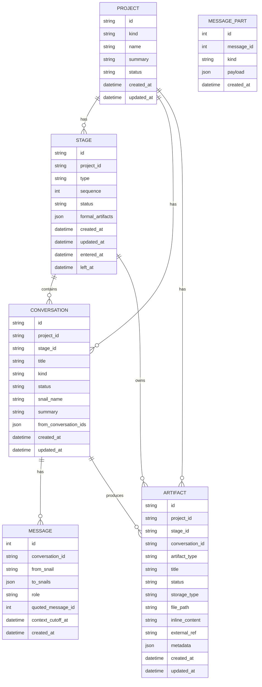

# Snail Shell Data Model V1

## 目的

本文档定义 Snail Shell 当前阶段的数据模型主框架。

这份模型不是围绕“文档管理”建立的，而是围绕 Snail Shell 的核心目标建立的：

记录一个 project 如何活过、如何推进、如何分阶段、多轮迭代地演进，以及在这个过程中留下了哪些 conversation、artifacts 和稳定痕迹。

因此，这份模型的核心不是 document，而是：

1. `Project`
2. `Stage`
3. `Conversation`
4. `Artifact`

其中，文档只是 artifact 的一种载体形式，代码也是 artifact 的一种形式。

## 核心原则

### 1. Project 是第一层

无论是 Snail Shell 自身，还是未来由 Snail Shell 产出的其他软件项目，最外层都统一是 `Project`。

Snail Shell 自身也被视为一个长期存在、持续演化、原则上不完结的 project。

### 2. Conversation 是第二层核心对象

某一个话题、某一次讨论、某一个 feature 的推进过程，本质上都对应一条 `Conversation`。

Conversation 不是附属记录，而是工作过程的主对象之一。

### 3. Artifact 是统一产物对象

不要把 document 单独视为知识体系核心。

`Artifact` 才是一等产物对象。

其中既包括：

- markdown 文档
- 结构化记录
- 代码提交信息
- 代码变更说明
- 设计结论
- 验收结果

代码只是产物的一种形式，不需要单独成为与 artifact 平级的核心实体。

### 4. Stage 是固定阶段链，而不是简单状态

Project 不只是有一个“当前阶段”字段，而是有明确的 stage chain。

这个 chain 按固定阶段推进，但推进过程中可能多轮反复。

例如：

`stage1 -> stage2 -> stage3 -> stage2 -> stage3 -> stage4 -> stage3 -> stage4 -> stage5`

这不应被理解为“回滚”，而应理解为：

项目在固定阶段链中的多轮迭代推进。

### 5. Conversation 之间的关系是来源关系

不维护 document-to-document 的主关系。

也不单独维护 `conversation_link` 表作为第一版主模型。

而是在 `Conversation` 本身上记录：

- `from_conversation_ids`

用来表达当前这条 conversation 来源于哪些历史 conversation。

### 6. 一个 Commit 只属于一个 Conversation

既然代码被纳入统一 artifact，那么 commit 也不需要通过额外中间表与 conversation 建多对多关系。

规则是：

1. 一个 conversation 可以产生多个 code artifacts / commit artifacts
2. 一个 commit 只能属于某一个 conversation

## 第一版核心实体图

## 实体定义

## 1. Project

Project 是最外层工作容器。

它代表一个长期存在的软件工作对象。

可以是：

1. Snail Shell 自身
2. 未来由 Snail Shell 产出的某个具体软件项目

### 字段

#### `id`

Project 的唯一标识。

#### `kind`

Project 类型。

当前建议值：

1. `system_self`
2. `product_delivery`

说明：

当前阶段虽然保留 `kind` 字段，但它暂时不驱动系统分支逻辑。

也就是说，Snail Shell 自身项目与其他项目，当前都先按统一 project 模型处理。

#### `name`

Project 名称。

#### `summary`

Project 的简短说明，用于概述这个 project 是什么。

#### `status`

Project 当前总体状态。

建议值：

1. `active`
2. `paused`
3. `completed`
4. `cancelled`
5. `archived`

#### `created_at`

Project 创建时间。

#### `updated_at`

Project 最近更新时间。

## 2. Stage

Stage 表示 project 在固定阶段链上的某一个阶段实例。

这里的重点是：

Snail Shell 不是“只存在一个阶段定义”，而是要保留阶段推进过程本身，因此 stage 必须能表达多轮迭代。

### 为什么不是简单回滚

之前提到“回滚”，但更准确的理解是：

项目在固定阶段链中做多轮推进。

因此，第二次进入 `product_design`，不应被简单视为“状态回退”，而应被视为：

在同一个 project 中，进入了新一轮的 `product_design` 阶段实例。

### 字段

#### `id`

Stage 实例唯一标识。

#### `project_id`

所属 project。

#### `type`

阶段类型，用于表示这个 stage 属于固定流程中的哪一类阶段。

建议值：

1. `initiative`
2. `requirement_discussion`
3. `product_design`
4. `software_design`
5. `implementation`
6. `delivery_acceptance`

#### `sequence`

该 stage 在 project 全部 stage chain 中的顺序位置。

注意：

这里是 project 实际经历的顺序，不是固定阶段定义中的理论顺序。

例如：

`stage1 -> stage2 -> stage3 -> stage2 -> stage3`

那么第二次进入的 `stage2`，它的 `sequence` 仍然应该是后面的新顺位。

#### `status`

该 stage 实例当前状态。

建议值：

1. `in_progress`
2. `completed`
3. `cancelled`

#### `formal_artifacts`

表示该 stage 的正式交付产物 `artifact id` 数组。

这是一个数组字段。

它记录的是“这个 stage 最终认定为正式交付物的 artifact 记录”。

例如：

1. `requirement_discussion` 阶段可能经历过多个中间 artifact，
   但最终被正式认定为交付物的可能只有其中 1 个或 2 个 artifact id

2. `software_design` 阶段可能产生了很多分析稿、补充稿、实现草案，
   但 `formal_artifacts` 中只放最终确认的正式产物 artifact id

3. `implementation` 阶段当前阶段至少需要一个代码交付类正式产物，
   当前先统一落在 `code_change_record` 上

这个字段表达的是：

`这个阶段最终正式交付了哪些 artifact`

而当前数据模型中的：

`Stage -> 多个 Conversation -> 多个 Artifact`

表达的是：

`这个阶段在真实工作过程中，实际产生了哪些全部产物`

因此两者的区别是：

1. `formal_artifacts`
   阶段最终确认的正式交付 artifact ids

2. `Conversation/Artifact` 链
   阶段实际产出的全量痕迹与全量产物

### 进入下一阶段的条件

当前阶段已经明确：

一个 stage 要进入下一步，必须有产物，不能凭空放行，也不能无产物中断。

并且，每一种 `stage.type` 都有对应的固定正式交付要求。

例如：

1. `requirement_discussion`
   必须有一个需求分析类正式产物

2. `implementation`
   必须有一个代码交付类正式产物

也就是说，一个 stage 在结束时，必须至少沉淀出一份“结论性产物”。

这份产物有两种可能：

1. 通过的正式交付产物
2. 不通过的结论 / 报告 / 分析类产物

因此 stage 的推进不是“状态直接变化”，而是“基于产物的状态变化”。

#### `created_at`

Stage 记录创建时间。

#### `updated_at`

Stage 记录更新时间。

#### `entered_at`

真正进入该阶段的时间。

#### `left_at`

离开该阶段的时间。

## 3. Conversation

Conversation 是第二层核心对象。

它表示某个 stage 下的一次具体工作讨论、设计推进、实现推进、复盘、修复等过程。

### 关键约束

1. 每个 conversation 只属于一个 project
2. 每个 conversation 只属于一个 stage
3. 不允许 conversation 跨阶段
4. 如果阶段切换了，应新建 conversation，并通过来源字段连接到旧 conversation

### 字段

#### `id`

Conversation 唯一标识。

#### `project_id`

所属 project。

#### `stage_id`

所属 stage。

#### `title`

Conversation 标题，用于描述这次讨论在做什么。

#### `kind`

Conversation 类型。

当前建议值：

1. `discussion`
2. `planning`
3. `design`
4. `implementation`
5. `review`
6. `bugfix`

#### `status`

Conversation 当前状态。

建议值：

1. `active`
2. `paused`
3. `completed`
4. `archived`

#### `snail_name`

表示这条 conversation 主要由哪个 snail 身份驱动。

例如：

1. `owner`
2. `product_agent`
3. `design_agent`
4. `implementation_agent`
5. `acceptance_agent`

这个字段的含义是：

这次 conversation 的主要工作责任归属于哪个 snail。

#### `summary`

对 conversation 的简要总结，用于快速检索和列表展示。

#### `from_conversation_ids`

表示当前 conversation 来源于哪些历史 conversation。

这是一个数组字段。

例如：

- `[]`
  表示它是一个起始 conversation

- `[A]`
  表示它主要来源于 conversation A

- `[A1, A2]`
  表示它综合来源于 A1 和 A2

它表达的是“当前 conversation 的来源”，而不是“未来谁依赖它”。

#### `created_at`

Conversation 创建时间。

#### `updated_at`

Conversation 最近更新时间。

## 4. Message

Message 是 conversation 内部的消息流记录。

它不是第二层核心知识对象，而是 conversation 的内容明细层。

这里的关键约束是：

1. `Message` 只作为消息实体锚点
2. 正文、过程态、终态不直接挂在 `Message` 行上
3. 这些内容统一通过 `MessagePart` 追加表达

### 字段

#### `id`

Message 唯一标识。

#### `conversation_id`

所属 conversation。

#### `from_snail`

消息发送方 snail。

对于 `system` 消息，通常为 `null`。

#### `to_snails`

消息目标 snail 列表。

它表达消息级路由结果，而不是消息正文。

#### `role`

消息发送方角色。

例如：

1. `user`
2. `assistant`
3. `system`

#### `quoted_message_id`

当前消息引用的历史消息 ID。

它主要服务于 UI 中的引用回复展示。

#### `context_cutoff_at`

生成这条消息时采用的上下文截断点。

#### `created_at`

消息创建时间。

### MessagePart

MessagePart 是统一消息模型的核心。

每条 message 的生命周期只允许由以下四类 part 组成：

1. `start`
2. `delta`
3. `result`
4. `end`

#### `start`

表示消息生命周期开始。

#### `delta`

表示消息过程态。

包括：

1. 流式文本
2. tool / mcp / skill 调用
3. 调用结果
4. 过程错误观测

#### `result`

表示消息正式结论。

当前核心格式包括：

1. `plain_text`
2. `structured_text`
3. `question`
4. `question_response`

#### `end`

表示消息终态。

当前核心终态包括：

1. `success`
2. `error`
3. `cancelled`
4. `interrupted`

### 约束

1. 不再使用 `message_type` 作为顶层消息语义
2. 不再把 `content` 作为 Message 行上的正式正文
3. 不再把 `metadata` 当成兜底消息结构
4. 统一规范以 `docs/core-message-model.md` 为准

## 5. Artifact

Artifact 是统一产物对象。

文档是 artifact 的一种，代码也是 artifact 的一种，commit 也是 artifact 的一种外在形式。

因此这里不再单独引入与 artifact 平级的 commit 实体。

### 关键约束

1. 每个 artifact 必须属于一个 project
2. 每个 artifact 必须属于一个 stage
3. 每个 artifact 必须至少关联一个 conversation
4. 一个 artifact 只能属于一个 conversation
5. 一个 conversation 可以产出多个 artifact

### 字段

#### `id`

Artifact 唯一标识。

#### `project_id`

所属 project。

#### `stage_id`

所属 stage。

#### `conversation_id`

来源 conversation。

这是关键字段，因为 Snail Shell 要保留“这个产物是从哪一次具体工作过程里长出来的”。

#### `artifact_type`

产物类型。

建议先支持：

1. `requirement_document`
2. `product_specification`
3. `technical_design`
4. `implementation_task_breakdown`
5. `acceptance_report`
7. `code_change_record`
8. `evolution_record`
9. `bug_analysis`

说明：

代码提交信息仍然可以作为 artifact 的一部分表达，但当前阶段正式交付要求先统一锚定在 `code_change_record` 这类代码交付记录上。

#### `title`

Artifact 标题。

#### `status`

Artifact 当前状态。

建议值：

1. `draft`
2. `active`
3. `approved`
4. `superseded`
5. `archived`

#### `storage_type`

表示正文或内容是以什么方式存储。

建议值：

1. `markdown_file`
2. `inline_text`
3. `json_record`
4. `external_ref`

#### `file_path`

如果内容以文件方式存在，这里记录文件路径。

#### `inline_content`

如果内容直接存数据库，这里存正文。

#### `external_ref`

如果内容不直接在本系统正文中，而是引用外部对象，这里存引用信息。

例如：

- commit hash
- branch name
- 外部文件路径

#### `metadata`

附加结构化信息，使用 JSON 保存。

对于 `code_commit` 这类 artifact，这里可以存：

- commit_hash
- branch_name
- commit_message
- diff_summary

#### `created_at`

Artifact 创建时间。

#### `updated_at`

Artifact 更新时间。

## 数据关系解释

### Project 与 Stage

一个 project 会经历多个 stage 实例。

这里不是“固定 6 个阶段一劳永逸”，而是“固定阶段类型 + 多轮迭代实例”。

### Stage 与 Conversation

一个 stage 下可以有多条 conversation。

例如：

- 一个主讨论 conversation
- 一个补充设计 conversation
- 一个 bugfix conversation

但每条 conversation 只能属于一个 stage。

### Conversation 与 Conversation 的关系

不额外维护独立的 conversation link 表。

而是在 conversation 自身上通过 `from_conversation_ids` 记录来源。

这样：

1. 新 conversation 出现时，只记录“我来源于谁”
2. 不需要维护未来反向依赖
3. 可以天然支持多来源链式关系

### Conversation 与 Artifact

一个 conversation 可以产出多个 artifact。

这是工作痕迹和产物之间最重要的一条连接。

## 当前阶段默认约束

当前先采用以下约束：

1. project 不支持子 project
2. stage 先使用固定阶段类型
3. conversation 不允许跨 stage
4. artifact 必须挂在 conversation 下
5. code 不单独建 commit 实体，而是并入 artifact

## 当前不做什么

第一版模型暂时不处理：

1. project 嵌套
2. 自定义 stage 模板
3. artifact 多来源归属
4. conversation 的复杂图数据库建模
5. 自动从所有文件反向推导完整知识图谱

当前重点是先把主干数据结构一次性做到当前阶段尽可能准确。

## 一句话总结

Snail Shell 当前阶段的数据模型，不是“文档中心模型”，而是“project 驱动、stage 约束、conversation 推进、artifact 留痕”的统一演进模型。
